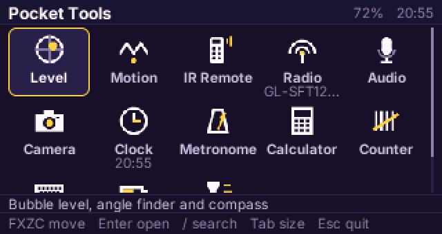
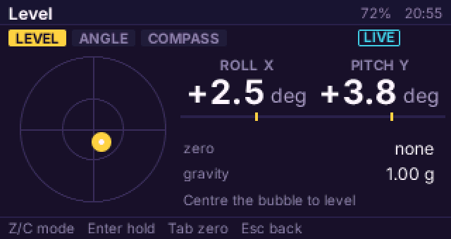
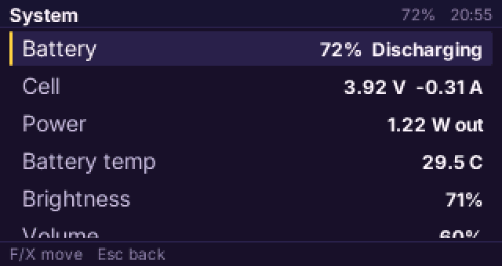
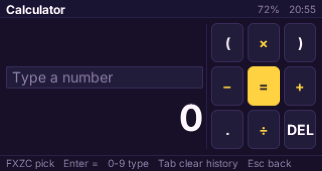

# Tools for the CardputerZero

**Tools** turns the M5Stack CardputerZero's own hardware into thirteen pocket instruments behind one icon grid: a bubble level and compass on the IMU, an IR remote that learns keys, a sound meter, spectrum, tuner and recorder, a Wi-Fi and Bluetooth scanner, a camera with a live viewfinder and a QR reader, and more. Every screen is driven by the keyboard, and every move animates at the panel's 30 frames a second. It is a [PocketJS](https://github.com/pocket-nexus/pocketjs) app built with the Pocket Compact UI Kit (`@pocketjs/framework/compact`); on the device it appears in the launcher as **Tools**.

| Grid sizes (Tab) | Level's sections (Z / C) | System's rows (F / X) |
| --- | --- | --- |
|  |  |  |

| Search (/) | Calculator |
| --- | --- |
|  |  |

The clips are frames of the app itself, rendered by the CardputerZero program with its device layer answering from synthesized readings (`bun scripts/zero.ts media`), one frame per tick.

## The tools

| Tool | What it shows and does | Hardware |
| --- | --- | --- |
| Level | Bubble level, angle finder on a ruler, tape compass; Enter holds, Tab zeroes or calibrates the compass | BMI270, BMM150 |
| Motion | Shake, acceleration per axis, a trace, the impact log | BMI270 |
| IR Remote | A pad of learned keys, Enter sends one; Learn captures a key from any remote, shows its pulses and NEC decode, saves it under a name | IR transmitter and receiver |
| Radio | Wi-Fi networks and Bluetooth devices nearby; one watched over repeated scans | Wi-Fi, Bluetooth |
| Audio | Level meter and waveform, 32-band spectrum, tuner with note and cents, recorder with its recordings | microphone, speaker |
| Camera | A live viewfinder at about 12 frames a second after libcamera's ten-second start; Enter keeps the frame on screen as a photo, Tab scans each frame for a QR code | camera |
| Clock | The time in large digits, a countdown timer that rings the speaker, a stopwatch with laps | RTC, speaker |
| Metronome | A tempo on a ruler, a pendulum crossing the panel each beat, a click from the speaker | speaker |
| Calculator | Digits typed on the keyboard, operators picked on a pad round `=` | |
| Counter | A hand counter: Enter for each person, lap or item, Shift for ten; kept between runs | |
| Keys | The name of every key pressed, for checking a keymap | keyboard |
| Flashlight | The panel as a lamp at full backlight, white, amber or red; the backlight comes back on leaving | backlight |
| System | Battery, network, memory and disk; brightness and volume adjusted in place | battery, backlight |

## Keys

One vocabulary on every screen (`docs/DESIGN.md`):

| Key | Does |
| --- | --- |
| F X Z C, or the arrows (Fn) | up, down, left, right; left and right switch a tool's sections |
| Enter | the focused action |
| Esc | back; held a second, home |
| / | search the tools |
| Tab | the screen's second action: the grid's size at home |
| Space | pause or record |
| Shift | the fine step of a value |

## Install

**From the CardputerZero Store**, once the listing is approved: search for Tools or the share code `TOOL`.

**From a release:** copy `pocket-zero-tools_<version>-1_arm64.deb` to the Zero and run `sudo dpkg -i pocket-zero-tools_*.deb`; APPLaunch lists Tools after it restarts. The package installs:

| Path | |
| --- | --- |
| `/usr/share/APPLaunch/bin/pocket-zero-tools` | the PocketJS CardputerZero program (pocketjs `programs/cardputer-zero`) |
| `/usr/share/APPLaunch/share/pocket-zero-tools/pocket-zero-tools.pocket` | this app, compiled for the program's profile |
| `/usr/share/APPLaunch/applications/pocket-zero-tools.desktop`, `share/images/pocket-zero-tools.png` | the launcher entry and its icon |
| `/usr/lib/tmpfiles.d/pocket-zero-tools.conf` | the CMA heap names rpicam-apps opens (`/dev/dma_heap/linux,cma`, `vidbuf_cached`) as links to `default_cma_region`, the Zero kernel's name; systemd-tmpfiles makes them at boot |

**The launcher starts Tools as `pi`; nothing runs as root.** Its files (the compass calibration, learned IR keys, recordings, photos, the counter) live in `~/.config/pocket-zero-tools/`.

## Build from source

Requirements: [Bun](https://bun.sh) 1.4.2 (`.bun-version`), Rust with `cargo-zigbuild` and zig for the aarch64 program, and ffmpeg for the README clips.

```sh
git clone --recursive https://github.com/pocket-nexus/pocket-zero-tools
cd pocket-zero-tools
bun run setup                              # vendor/pocketjs's packages, linked into node_modules
bun scripts/zero.ts deb                    # .build/pocket-zero-tools_<version>-1_arm64.deb
bun scripts/zero.ts install root@<address> # the .deb over SSH with dpkg, then APPLaunch restarts
bun scripts/zero.ts tour                   # one shot of every tool, rendered on this computer
bun scripts/zero.ts shot --script "40:shot 42:key:Tab 50:shot"
bun run test                               # the calculator's parser and the worker records
```

`vendor/pocketjs` pins the PocketJS commit the app is built against; `POCKETJS=<checkout>` builds against another.

## How it is built

- **The screen** (`app/`) is a Solid app on the Pocket Compact UI Kit: `CompactApp`'s status bar, scenes and hint bar, the `AppGrid` home, and one scene per tool in `app/applets/`. A tool is one row in `app/applets/index.ts` and one baked 24-unit SVG icon in `app/icons/`.
- **The worker** (`app/worker.ts`). A PocketJS UI realm has no network. The app's worker owns the program's `http` node and performs each device API call (`http://zero/dev/<topic>`); the screen and the worker exchange 1 KiB records over two channels (`app/wire.ts`). `app/device.ts` turns them back into topics that poll while their scene is on top.
- **The program** is pocketjs's CardputerZero program: the panel with a flush after every frame, the keyboard as buttons and text keys, the worker, and the device API in process (the IMU over IIO, power supply, `nmcli`, `bluetoothctl`, `arecord` with an FFT and a pitch detector, LIRC, `rpicam-vid`). **The camera's picture is the runtime's video plane: the program copies each decoded frame into the viewfinder's texture, so no frame crosses JavaScript.** Its README lists every route.

## Design

[`docs/DESIGN.md`](docs/DESIGN.md) states the design language: glance first, one key vocabulary, the width spent before the height, instruments over numbers, and short motion run by the core. The kit's contract is [`docs/COMPACT-UI.md`](https://github.com/pocket-nexus/pocketjs/blob/main/docs/COMPACT-UI.md) in PocketJS.

## The CardputerZero Store

`app-builder.json` carries the Store listing (title, summary, icon, screenshots, categories, permissions, share code). `bun scripts/zero.ts check` runs the Store's own policy scripts on it and on the `.deb`'s install paths, and `czdev publish --deb .build/pocket-zero-tools_<version>-1_arm64.deb` (from [CardputerZero/AppBuilder](https://github.com/CardputerZero/AppBuilder)) opens the listing's pull request on CardputerZero/packages. A first listing needs a video of the app on the device in that pull request.

## License

MIT (`LICENSE`). The package also carries the CardputerZero program built from PocketJS, under PocketJS's license.
